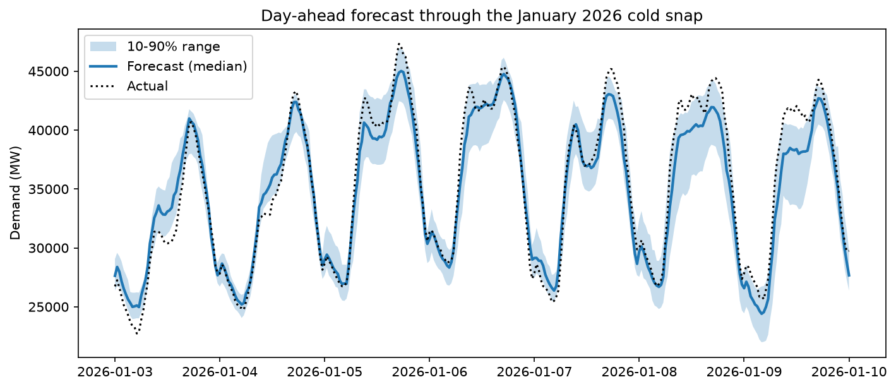
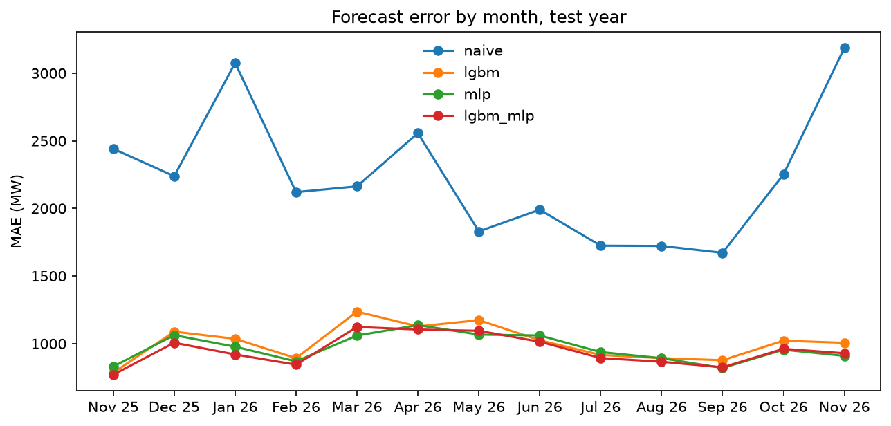
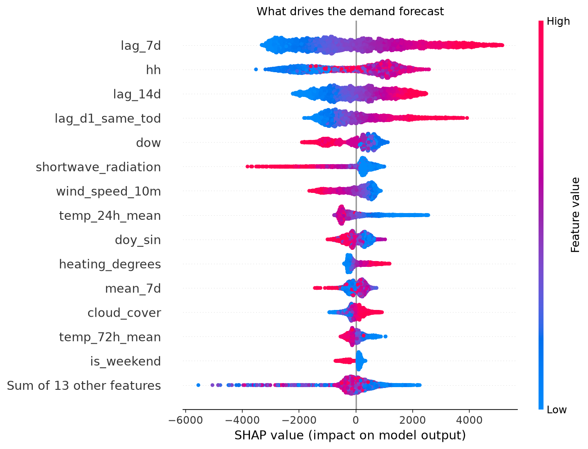
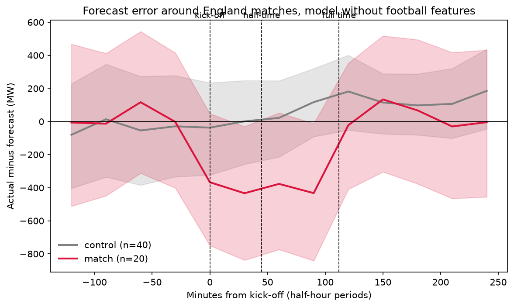

# GB Grid Forecaster

Every morning at 06:00 this project forecasts Great Britain's electricity demand for the
next 48 hours, half-hour by half-hour, with an 80% uncertainty range. Then it scores
itself against what actually happened.

**[Live dashboard](https://connorlava42.github.io/gb-grid-forecaster/)** · forecasting
unattended since November 2026 · live accuracy updated every morning on the dashboard

<!-- TODO: if your first automated run was not in November 2026, change the date above. -->

*Day-ahead forecasts for the week of the January 2026 cold snap, when GB demand reached its
highest level since 2018. Shaded: the 10–90% range. Dotted: what actually happened.*

<!-- TODO: if your fan chart shows a different week, change the caption above. -->

## Headline

Over a 12-month rolling-origin backtest (Nov 2025 – Oct 2026, refitted every month), the
production model, LightGBM with a conformal correction, cut the error of a seasonal-naive
forecast by **53%**: MAE **1,008 MW** against 2,152 MW, and MAPE 4.2% against 8.5%. Its 10–90%
band covered **79.3%** of outcomes, against a target of 80%. On the same days NESO's own
day-ahead forecast scored 773 MW, against 1,006 MW for this model's day-ahead forecasts.

## Results

Test year Nov 2025 – Oct 2026. Every row is a 48-hour forecast issued at 06:00 using only
data published before 06:00.

| Model | MAE (MW) | MAPE | Error cut vs naive | Pinball | 10–90 coverage | MAE D+1 (MW) |
| --- | ---: | ---: | ---: | ---: | ---: | ---: |
| Seasonal naive (same time last week) | 2,152 | 8.48% | – | 697 | 79.6% | 2,151 |
| LightGBM | 1,008 | 4.16% | 53.1% | 340 | 64.0% | 1,006 |
| LightGBM, residual target | 1,050 | 4.30% | 51.2% | 357 | 62.6% | 1,047 |
| LightGBM, no football features | 1,002 | 4.13% | 53.4% | 337 | 64.5% | 1,002 |
| PyTorch MLP | 974 | 4.01% | 54.8% | 309 | 73.7% | 968 |
| LightGBM + MLP average | **954** | **3.95%** | **55.7%** | **306** | 71.2% | **950** |
| **LightGBM + conformal (production)** | 1,008 | 4.16% | 53.1% | 330 | **79.3%** | 1,006 |
| NESO day-ahead (benchmark) | – | 3.17% (D+1) | – | – | – | 773 |

- Every learned model roughly halves the naive error.
- The LightGBM + MLP average is the most accurate: the two models make different mistakes,
  so some cancel out.
- Predicting the change from last week (residual target) made LightGBM worse, not better.
- NESO's day-ahead forecast is still about 19% better than the best model here.

### Why production uses LightGBM + conformal, not the most accurate model

Raw quantile models are overconfident: LightGBM's 10–90% band caught only 64% of outcomes.
Conformalised quantile regression (CQR) widens the band by an amount learned from recent
errors. That brought coverage to 79.3% without moving the median forecast, and cut pinball
loss from 340 to 330.

| | 10–90 coverage (target 80%) | Pinball loss |
| --- | ---: | ---: |
| LightGBM | 64.0% | 340 |
| LightGBM + conformal correction | **79.3%** | 330 |
| LightGBM + MLP average | 71.2% | **306** |

The average is about 5% more accurate, but its band is still too narrow and it needs PyTorch
in the daily job. Production went with calibrated uncertainty and a light setup; applying
the conformal correction to the average is the obvious next step.

### Error by month

The naive forecast's worst month was January 2026. A cold snap followed the New Year
holiday, so "same time last week" was a quiet holiday week: naive MAE peaked near 3,000 MW
while the learned models stayed under 1,000 MW. Weather features matter most when the
weather changes fast. The models' own hardest periods were Christmas and March to June.

## How it works

1. **Data:** half-hourly GB demand (Elexon INDO) and archived weather forecasts for eight
   population-weighted cities (Open-Meteo), 2021 to today, plus bank holidays and England
   match fixtures.
2. **Features without leakage:** every training row is a simulated 06:00 forecast that only
   uses data published before 06:00. A test scrambles all future demand and checks that no
   feature changes.
3. **Model ladder:** seasonal naive → LightGBM quantile regression (tuned with Optuna on a
   separate year, Nov 2024 – Oct 2025) → a PyTorch MLP → their average. Each is scored with
   the same rolling-origin backtest, which refits every month.
4. **Honest uncertainty:** conformalised quantile regression recalibrates the 10–90% band.
5. **Tracking:** every backtest is logged to MLflow with its settings, metrics, git commit
   and predictions.
6. **Production:** GitHub Actions forecasts every morning, commits the forecast before the
   actuals exist, scores past forecasts, rebuilds the dashboard, and retrains monthly with a
   guardrail that keeps the old model if the new one is worse.

## What drives demand

<!-- TODO: check these two sentences against your shap_beeswarm.png and edit to match. -->

Time of day and temperature dominate: cold weather pushes demand up, most of all around the
evening peak. Solar radiation pulls daytime demand down, because rooftop and small solar
farms supply homes directly and that power never shows up on the transmission network.

## Does football move the grid?

During England matches, GB demand runs about **400 MW (roughly 1–1.5%) below** what a model
without football features expects, and returns to normal within half an hour of full time.
Control nights at the same times one and two weeks earlier show no such dip. The evidence is
the sustained shift across the whole match: with 20 matches, individual half-hours are too
noisy to call on their own. Half-hourly data is also too coarse to show the famous half-time
kettle surge.

Adding match features to the model didn't measurably change overall accuracy (MAE 1,008 MW
with them, 1,002 MW without), because matches cover only a few dozen half-hours a year.

## Reproduce it

    git clone https://github.com/ConnorLava42/gb-grid-forecaster.git
    cd gb-grid-forecaster
    uv sync --extra nn
    uv run gridforecast ingest --oracle      # about 15 minutes
    uv run gridforecast build
    uv run gridforecast backtest --model naive
    uv run gridforecast backtest --model lgbm_cqr
    uv run gridforecast compare
    uv run pytest

## Project structure

    src/gridforecast/data/        API clients, cleaning, holidays, fixtures
    src/gridforecast/features/    the forecast-origin feature table
    src/gridforecast/models/      naive, LightGBM, PyTorch, conformal, tuning
    src/gridforecast/evaluation/  metrics and rolling-origin backtest
    src/gridforecast/pipeline/    ingest, tables, the daily production loop
    notebooks/                    EDA, calibration, TV pickup
    tests/                        37 offline tests against fake APIs

Built with Python 3.13, uv, pandas, LightGBM, PyTorch, Optuna, MLflow, SHAP, Plotly, pytest,
ruff and GitHub Actions.

## Limitations and next steps

- The backtest's weather comes from Open-Meteo's archive of past forecasts, which stitches
  recent model runs together, so it is usually shorter-range than a real 24–66 hour
  forecast. Backtest error is slightly optimistic; the live score is the true test.
- INDO is an initial operational figure and settlement data can differ slightly.
- No embedded-solar input. Errors rise from March to June, probably because rooftop solar
  cuts daytime transmission demand by amounts that depend on hard-to-forecast cloud. NESO's
  embedded solar forecast is the next feature to add.
- National totals only; no regional model.
- The football study rests on 20 matches at half-hourly resolution.
- Retraining is monthly, so sudden structural changes take a few weeks to be learned.

## Data and credits

Demand: Elexon BMRS (Insights Solution). Weather: [Open-Meteo.com](https://open-meteo.com/),
CC BY 4.0. Benchmark: NESO day-ahead demand forecast via Elexon.